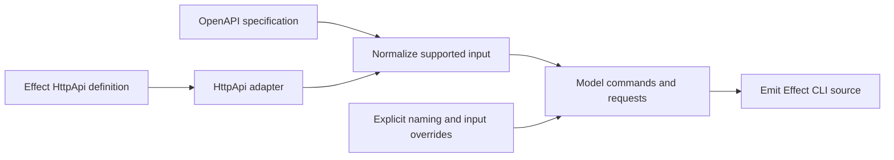

# Project direction

## Purpose

Build `effect-openapi-cli-generator`: a reusable TypeScript package and generator CLI that produce standalone, maintainable Effect CLI source from OpenAPI specifications or Effect HttpApi definitions. Generated applications should feel like code an Effect developer would choose to maintain.

The repository currently contains tooling only. This document describes the intended behavior, not existing functionality. npm publication is a future release decision.

## Cloudflare inspiration

[Cloudflare Forge](https://github.com/cloudflare/forge) is a schema-first OpenAPI generation framework with specification resolution, JSONPath overlays, and output plugins. Its first output is the [cf CLI](https://github.com/cloudflare/cf).

Use Forge and cf as concrete references for turning API operations into useful commands: grouping and naming, schema-derived arguments, request bodies, files, and explicit customization. Build those capabilities around Effect libraries and runtime. This is an independent project, unaffiliated with Cloudflare or the Effect maintainers.

The intended input is OpenAPI JSON conforming to a documented supported subset, not arbitrary JSON data. Accept general API specifications rather than hard-coding Cloudflare's API. Study Forge's supported cases and overrides before defining ours; full feature parity and universal OpenAPI support are not assumed. Inspect [Effect's existing OpenAPI generator](https://github.com/Effect-TS/effect/tree/main/packages/tools/openapi-generator) for reusable functionality before recreating it.

## Generation flow

Both input forms should feed a common generation pipeline. Determine what HttpApi metadata survives conversion and preserve any needed metadata explicitly.

Operation metadata and overrides determine command names and grouping. Do not infer CRUD behavior from HTTP verbs or assume every operation is REST-shaped. Each generated handler must retain its operation's HTTP method, path, parameter locations, serialization, body encoding, and authentication requirements.

Map representable schema fields to typed CLI inputs. Provide documented JSON and file input conventions for complex bodies and uploads. Choose precise flag, positional, nesting, precedence, and collision rules during implementation; the earlier conversational examples do not settle those contracts. Diagnose unsupported or ambiguous cases instead of silently changing request meaning.

## Code organization

- `src/core/`: the reusable generator, input adaptation, command modeling, and code emission.
- `src/cli/`: the generator's executable interface, input/output, configuration, and runtime assembly; it calls the core library.
- `tools/`: repository tooling such as custom lint rules.
- `docs/`: project intent and documented contracts.

Use kebab-case filenames. Keep modules focused and add them when real behavior needs them. The separation of library and executable concerns is inspired by Rust project organization; use ordinary TypeScript entry points and exports. Exact filenames, public API signatures, test placement, and service boundaries remain implementation decisions. Effect's own package layout is a reference, not our required layout.

## Generated-code quality

- Use Effect's CLI, Schema, HTTP, Config, FileSystem, and runtime facilities where applicable. Use its process and resource facilities when a feature requires them.
- Preserve schema constraints and wire representations through decoding and request construction. Report failures through typed errors with actionable context.
- Keep failing external operations inside small Effect boundaries. Follow the repository's ban on native try/catch; avoid wrapping an entire workflow in Effect.tryPromise.
- Emit readable TypeScript with useful names, explicit imports, and small handlers. Avoid untyped escape hatches and redundant abstraction layers.
- Make output deterministic for the same specification and options. Generated source must pass the project's formatting, linting, and type checks.
- Provide useful help, explicit configuration/authentication inputs, predictable exit behavior, and output suitable for scripts. Keep credentials out of generated source and diagnostic output.
- Verify generated applications themselves: compile them and exercise commands against controlled HTTP fixtures, checking requests and success/error behavior. Checking only the generator is insufficient.

## Scope and next work

Start with a small end-to-end slice: accept a supported specification, generate a real Effect command, compile it, and verify the resulting HTTP request. Expand supported inputs and overrides from tested contracts.

This foundation does not include examples, benchmark suites, infrastructure, or Alchemy. Large public API specifications can later measure generation time, memory, output size, startup cost, and supported-operation coverage. Add those evaluation assets in a separate implementation task.
