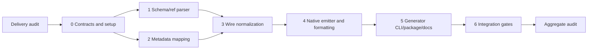

# OpenAPI JSON to Effect CLI Implementation Plan

> **For agentic workers:** REQUIRED SUB-SKILL: Use superpowers:subagent-driven-development or superpowers:executing-plans task-by-task. The operator has selected **Tugboat Mind/Hand**; preserve that execution method. Mind routes the units below, Hands implement, and independent seats own the declared audit/integration gates. Steps use checkbox syntax for tracking.

**Goal:** Generate and execute nested Forge-style CLIs using native Effect libraries from enriched OpenAPI JSON.

**Architecture:** Decode untrusted JSON into a validated operation/schema model, then deterministically emit direct Effect command definitions and a small reusable HTTP/body helper. Keep generator filesystem access in its CLI; generated applications depend only on Effect and its Node platform.

**Tech Stack:** Bun 1.4.3; TypeScript 7.0.2; `effect` 4.0.3; `@effect/platform-node` 4.0.3; Node ESM runtime; Bun tests; existing Vite+/Ultracite hygiene.

**Spec:** `docs/superpowers/specs/2026-10-11-generator-design.md`.

## Global Constraints

- OpenAPI JSON is primary; HttpApi shorthand remains deferred.
- One package; no examples, benchmarks, infrastructure, or artificial package hierarchy.
- Keep this repository private; no push, publication, deployment, or merge to main.
- Generate native Effect CLI commands, flags, help, parsing, and validation; no custom parser or runtime OpenAPI interpreter.
- Keep HTTP methods, paths, property names, and request values independent of command spelling.
- Use resource/action metadata, arbitrary nesting, optional name/title default, explicit shared `--base-url`, and JSON `--body` or `--body-file` inputs. Follow the spec’s exact metadata skip/projection rules.
- Reject unsupported request semantics with typed location-bearing errors before producing files.
- No silent coercion, default application, unknown-field stripping, request retry, or skipping outside documented metadata selection.
- The generator library performs no filesystem/network access. Generated output does not import the generator.
- Preserve unrelated dirt. Planning baseline is `2d7e15b905644b61b8e78bb4c6f0ba84d7f57dcf`; `.vivi/` is foreign coordination state.

## Review Focus

1. API strings containing quotes, newlines, backticks, `${...}`, `__proto__`, or code must remain data (Units 3–4).
2. Optional boolean `false`, empty string, zero, and absent query/body values must remain distinct (Units 3–4 and 6).
3. Version-dependent nullable/ref semantics and nested additional properties must not silently widen/narrow requests (Units 1 and 6).
4. Base paths, encoded separators, dot segments, and parameter-name collisions must not route a request elsewhere (Units 3–4 and 6).
5. Existing output targets, halfway write failures, HTTP errors, and interruption must produce truthful failure without foreign-data loss (Units 5 and 6).

## Repository and API evidence

README says tooling foundation only. Existing scripts are `format`, `lint`, `typecheck`, `check`, `fix`; tsconfig includes only `vite.config.ts`. Baseline preparation has now installed pinned dependencies on codex/openapi-generator. Earlier source inspection used the primary checkout’s installed packages, whose metadata reports 4.0.3. Planner did not change dependencies.

Verified from installed source:

- `effect/cli`: `Command.make`, `Command.withSubcommands`, `Command.withSharedFlags`, `Command.withDescription`, `Command.run`; descendants read shared values using `yield* parentCommand`.
- `Flag.String`, `Flag.Boolean` (presence/`--no-name`), `Flag.Int`, `Flag.Finite`, `Flag.Literals`, `Flag.optional` (`Option`), `Flag.mapEffect`, `Flag.withDescription`, `Flag.Path`.
- `effect`: `Schema.TaggedError<Self>()`, `Schema.Struct`, `Schema.StructWithRest(struct, [record])`, `Schema.Record(key, value)`, `Schema.optionalKey`, `Schema.Array`, `Schema.Literals`, `Schema.NullOr`, `Schema.Finite`, `Schema.Int`, `.check`, `Schema.makeFilter`, `Schema.decodeUnknownEffect(schema, options)(input)`.
- `SchemaAST.ParseOptions.onExcessProperty` accepts only `ignore` or `error`; default `ignore` strips keys. Do not assume a `preserve` mode.
- `effect/http`: `HttpClientRequest.make(method)(url)`; `HttpClientRequest.bodyJson(request, value)` returns an Effect; `HttpClient.execute(request)`; response `status` and `text` Effect. Do not derive the method from the command.
- `@effect/platform-node`: `NodeServices.layer`, `NodeHttpClient.layerNodeHttp`, `NodeRuntime.runMain`.
- `FileSystem.FileSystem` includes `readFileString`, `makeDirectory`, `writeFileString`, `remove`; exclusive directory creation uses `makeDirectory` without recursive mode. `Stdio` exposes stdout/stderr sinks; `Stream.make(text).pipe(Stream.run(stdio.stdout({ endOnDone: false })))` avoids added output newlines.

Source locations: `node_modules/effect/src/cli/{Command,Flag,GlobalFlag}.ts`, `Schema.ts`, `SchemaAST.ts`, `http/{HttpClient,HttpClientRequest,HttpClientResponse,HttpIncomingMessage}.ts`, `FileSystem.ts`, `Stdio.ts`, and `node_modules/@effect/platform-node/src/{NodeServices,NodeHttpClient,NodeRuntime}.ts`.

Version semantics checked against [OAS 3.0.3](https://spec.openapis.org/oas/v3.0.3.html) and [OAS 3.1.1](https://spec.openapis.org/oas/v3.1.1.html). Vault filename/content search found only Blu's unrelated Forge; that note does not describe Cloudflare Forge or this repository. No matching project note was found or changed.

## Exact contracts and emitted files

Public export from `src/index.ts`:

```ts
interface GenerateOptions { readonly name?: string }
interface GeneratedFile { readonly path: string; readonly content: string }
interface GeneratedApplication { readonly files: ReadonlyArray<GeneratedFile> }
// Input is parsed JSON, not JSON text. No hidden filesystem service requirement.
generate(document: unknown, options?: GenerateOptions): Effect.Effect<GeneratedApplication, GenerationError>
```

`GenerationError` is one `Schema.TaggedError` with `code: "invalid_input" | "unsupported" | "invalid_options" | "format"`, `location: string` (escaped JSON Pointer, or `/options/name`), `message: string`, and `hint: string`. Empty hint means no supported alternative. Fail deterministically at the first invalid location in lexical traversal. Catch expected boundary exceptions with `Effect.try`; do not turn programmer defects into success/fallbacks.

When supplied, `name` must match `/^[a-z][a-z0-9]*(?:-[a-z0-9]+)*$/` and avoid reserved root/global command spellings. It is the generated package/bin/root command name. Otherwise slug info.title by separating acronym/camel boundaries, replacing runs of non-ASCII-alphanumeric characters with hyphens, trimming hyphens and lowercasing; validate with the same expression. A failed title slug asks for --name. Keep original title/description for display/help. Generated package and CLI version is `0.0.0`; API info.version never becomes package semver.

Emit exactly five files, in the following fixed order, with LF and final newline:

1. `src/main.ts`: shebang, generated schemas/explicit commands, root/runMain wiring.
2. `src/runtime.ts`: small generated helper for base URL, JSON body, HTTP execution, errors, stdout/stderr.
3. `package.json`: private ESM package, bin `{ [name]: "./dist/main.js" }`, dependencies pinned to the two 4.0.3 packages, TypeScript 7.0.2 and `@types/node` 26.6.4 dev dependencies. Scripts `build: tsc -p tsconfig.json`, `start: node dist/main.js`.
4. `tsconfig.json`: strict, ES2022, NodeNext module/resolution, rootDir `src`, outDir `dist`, declarations false, types node, includes `src/**/*.ts`.
5. `.gitignore`: `node_modules/` and `dist/` only.

Imports between generated files use `.js`. Generator library build similarly uses NodeNext with `.js` source imports; build output preserves a shebang on `dist/cli.js`.

Generator invocation: `effect-openapi-cli-generator --input ./openapi.json --output ./generated --name my-api`. Input/output flags are required; --name is optional. Generated invocation: `my-api reports get abc --base-url https://host.test/api --body '{"enabled":false}'`. Help works without base-url; invocation without an operation renders native root help.

Internal model in `src/model.ts`:

```ts
type HttpMethod = "GET" | "PUT" | "POST" | "DELETE" | "OPTIONS" | "HEAD" | "PATCH" | "TRACE";
type JsonScalar = string | number | boolean | null;
interface Documentation {
  readonly title?: string;
  readonly description?: string;
  readonly deprecated?: boolean;
  readonly externalDocs?: { readonly url: string; readonly description?: string };
}
type WireSchema = { readonly docs: Documentation } & (
  | {
      readonly kind: "string" | "boolean" | "integer" | "number" | "null";
      readonly nullable: boolean;
      readonly enum: ReadonlyArray<JsonScalar> | undefined;
    }
  | { readonly kind: "array"; readonly nullable: boolean; readonly items: WireSchema }
  | {
      readonly kind: "object";
      readonly nullable: boolean;
      readonly properties: ReadonlyArray<{
        readonly name: string;
        readonly required: boolean;
        readonly schema: WireSchema;
      }>;
      readonly additionalProperties: boolean;
    }
);
interface Parameter {
  readonly wireName: string;
  readonly flagName: string;
  readonly location: "path" | "query";
  readonly required: boolean;
  readonly schema: WireSchema;
  readonly docs: Documentation;
  readonly binding: "flag" | "argument";
}
interface Operation {
  readonly commandPath: ReadonlyArray<string>;
  readonly operationId: string;
  readonly method: HttpMethod;
  readonly path: string;
  readonly parameters: ReadonlyArray<Parameter>;
  readonly docs: Documentation;
  readonly body: { readonly required: boolean; readonly schema: WireSchema } | undefined;
}
interface ApiModel {
  readonly title: string;
  readonly description: string | undefined;
  readonly operations: ReadonlyArray<Operation>;
}
interface CommandProjection {
  readonly commandPath: ReadonlyArray<string>;
}
```

Body enums are restricted to JSON scalar values matching the declared primitive type. Arrays/object enum values are rejected. Null enums do not override nullable/version semantics. No validation keyword is lost from this model: unsupported restrictions are rejected before normalization.

Internal signatures:

```ts
normalizeSchema(document: unknown, schema: unknown, location: string, version: "3.0" | "3.1", activeRefs?: ReadonlySet<string>): Effect.Effect<WireSchema, GenerationError>
normalize(document: unknown): Effect.Effect<ApiModel, GenerationError>
mapCommands(operation: unknown, location: string): Effect.Effect<ReadonlyArray<CommandProjection>, GenerationError>
resolveName(title: string, options?: GenerateOptions): Effect.Effect<string, GenerationError>
emit(model: ApiModel, options?: GenerateOptions): Effect.Effect<GeneratedApplication, GenerationError>
```

`normalizeSchema` owns schema references; `normalize` owns parameter/requestBody references. `resolveReference(document: unknown, ref: string, location: string, activeRefs: ReadonlySet<string>)` in `src/references.ts` returns `{ value: unknown; location: string; activeRefs: ReadonlySet<string> }` through `Effect<..., GenerationError>`; takes `(document: unknown, ref: string, location: string, activeRefs: ReadonlySet<string>)`. It never mutates its input. The active reference set follows only the current traversal branch; repeated shared references are not cycles.

## Supported/rejected behavior

### Schema keyword matrix

| Feature                   | Supported interpretation                                                                                                          | Reject                                                                                                                                                                                                                                                                                                                                     |
| ------------------------- | --------------------------------------------------------------------------------------------------------------------------------- | ------------------------------------------------------------------------------------------------------------------------------------------------------------------------------------------------------------------------------------------------------------------------------------------------------------------------------------------ |
| `type`                    | 3.0 one explicit primitive/object/array type; 3.1 same plus `null`, or exactly one non-null type plus null in a two-member array  | missing type, boolean schema documents, other type unions/types                                                                                                                                                                                                                                                                            |
| `nullable`                | 3.0 boolean, only alongside explicit type; 3.1 null union/type                                                                    | `nullable` in 3.1; nullable path/query parameters                                                                                                                                                                                                                                                                                          |
| `properties`, `required`  | object properties, unique required strings that name declared properties; absent required means none                              | required undeclared fields; malformed lists; these keywords on non-object                                                                                                                                                                                                                                                                  |
| `additionalProperties`    | absent/true allows arbitrary JSON extras; false rejects extras recursively                                                        | schema-valued additionalProperties in this slice                                                                                                                                                                                                                                                                                           |
| `items`                   | one supported schema, required for array                                                                                          | tuple/prefixItems, missing items                                                                                                                                                                                                                                                                                                           |
| `enum`                    | nonempty unique JSON primitive values consistent with type/nullability                                                            | objects, arrays, inconsistent or duplicate values                                                                                                                                                                                                                                                                                          |
| `$ref`                    | `#/...` JSON Pointer, ~0/~1 escaping and percent-decoded fragment; local schemas/parameters/requestBodies; own-property traversal | external, unresolved, recursive, invalid escaping; validation siblings on schema refs in 3.1; request-affecting reference siblings                                                                                                                                                                                                         |
| descriptive annotations   | title, description, deprecated, default, example(s), externalDocs, `$comment`, and `x-*`; never applied as defaults               | unknown non-annotation keywords                                                                                                                                                                                                                                                                                                            |
| other validation/encoding | none in first slice                                                                                                               | minimum/maximum, exclusive bounds, multipleOf, min/maxLength, pattern, format, min/maxItems, uniqueItems, min/maxProperties, const, allOf/oneOf/anyOf/not, discriminator, readOnly/writeOnly, XML, contentEncoding/mediaType, patternProperties, unevaluatedProperties, conditionals, `$id`/anchors/dynamic refs, custom `$schema`/dialect |

This is an explicit subset, not a promise to accept every primitive schema restriction. Native schemas represent supported type/enum/required/null/additional-property rules; unsupported restrictions produce location + hint instead of disappearing. JSON unknown additional values are safe because bodies originate in JSON parsing. Always send the original parsed value after successful decode, never the decoder's result. Closed objects use `Schema.Struct` with excess-property error; open objects use `Schema.StructWithRest(..., [Schema.Record(Schema.String, Schema.Unknown)])`. Use computed object keys or entry arrays for untrusted names such as `__proto__`.

### Operation/parameter normalization

- Accept `openapi` matching `3.0.x`/`3.1.x` numeric patch, valid `info` title/version and `paths` object; reject no-operation documents and other versions. Select metadata projections first; validate selected request-bearing locations and reachable schemas/parameters/requestBodies. Skip unselected operations before their unsupported request features are examined. Responses are structurally checked and scanned for links; their schemas are intentionally not converted or judged by the request-schema subset. Unknown request keys fail; ordinary documented metadata and `x-*` may be ignored.
- Iterate paths lexically and methods in fixed order GET, PUT, POST, DELETE, OPTIONS, HEAD, PATCH, TRACE. Only these method keys are operations. Reject webhooks, callbacks, response links, path-item refs, and nonempty root or operation security requirements. Empty `security: []` is supported. Unused security scheme definitions are descriptive to this slice.
- `mapCommands` selects operations using the spec’s Forge init rules. Group may be dotted string or nonempty string array; trim segments, normalize camel/acronym boundaries and underscores to kebab lowercase, reject empty/unsafe tokens. Alias array replaces primary projection, including empty array; alias entries must contain a valid group. Missing/empty method falls back to final `operationId.split(/[-_]+/)` segment or `get`. Missing/nonstring operationId skips. Absent group with absent aliases skips; supplied malformed metadata fails. Duplicate operationId alone is not a command collision: compare full normalized command paths globally. Reject action/group prefix conflicts. Preserve all projections’ identical HTTP semantics.
- For each projection use path-placeholder order: last path parameter is an Argument unless final action is `list`, `bulk`, or starts `bulk-`; earlier path parameters and every query parameter are Flags. No path parameter means no positional. Normalize flag names, retaining wire names. For booleans use native true/false literal value flags/arguments mapped to booleans. Thus --enabled false is explicit false; absent required input fails and optional input stays None. Do not use default-false presence flags.
- Flag spelling uses the same normalization but retains original wire name. Reject collisions within each operation, reserved names `base-url`, `body`, `body-file`, `help`, `h`, `version`, `v`, `wizard`, `completions`, `log-level`, and any automatically generated spellings actually exposed by native flags. This slice uses explicit boolean literals and does not expose no- aliases. Do not reserve harmless wire names globally across separate commands.
- Merge path-item and operation parameters by `(in, name)`, with operation override. Reject duplicates within either source list. Path parameters must be required, have exactly matching placeholders, and use simple style. Query parameters use form style. Accept boolean explode defaults or either boolean when it has no effect on primitive serialization; reject allowReserved true, allowEmptyValue true, content parameters, header/cookie locations, and arrays/objects/nullability. Optional query remains Option, including false/zero/empty string when present.
- Paths start with `/`; reject query/fragment components, malformed placeholders, URL dot segments, ambiguous duplicate templated paths, and literal unescaped whitespace/control characters. Never interpolate path values as source. Validate supplied base URL as http(s), with no credentials/query/fragment; join by trimming trailing base slash and appending operation path without replacing base path. RFC3986-encode substituted primitive path values once; query uses URLSearchParams with original names. Reject standalone dot/dot-dot path substitutions because WHATWG URL normalization would alter routing.
- Request body content must be exactly `application/json` with a schema; reject other or multiple media choices and encoding directives. Optional absence sends no Content-Type/body. Inline --body is JSON only, with no @file shorthand. Required body needs exactly one input; both inputs always fail. No-body operations expose neither body flag. Reject GET/HEAD request bodies explicitly: the target HTTP client cannot faithfully promise them.
- Documentation stores summary then description separated by newline for operations, description/title for schemas and parameters, deprecated and externalDocs. Emit escaped meaningful JSDoc on generated declarations/properties, @deprecated and @see only when present. Replace `*/` with `*\/`, escape leading @ in prose lines, and treat all other source text as JSON-escaped literals. No synthetic explanatory comments. Native help carries these descriptions.

### Generated execution

Use generated constants `schema0`, `operation0`, and `parameter0` keyed by deterministic ordinals; never untrusted identifiers. Arbitrary-depth group Command nodes are constructed using withSubcommands, with final action Command leaves. Root is created before child handlers so `yield* root` reads shared `baseUrl`. Bind `Flag.String("base-url")` with `Flag.mapEffect` URL validation; other flags use native types or string literals, with `Flag.optional` only for optional values. Boolean parameters use explicit true/false literals mapped without coercion. Config supplies the explicit base-url value to shared request configuration, without introducing environment fallback.

Generated `src/runtime.ts` contract:

```ts
type RequestFailure = InvalidBaseUrl | InvalidBody | RequestFailed | HttpStatusFailure
// Schema.TaggedError classes; InvalidBody has message/source, RequestFailed message,
// HttpStatusFailure status/body; InvalidBaseUrl message/value.
validateBaseUrl(value: string): Effect.Effect<string, InvalidBaseUrl>
readBody(input: { readonly body: Option.Option<string>; readonly bodyFile: Option.Option<string> }, required: boolean, schema: Schema.Codec<unknown>): Effect.Effect<Option.Option<unknown>, InvalidBody, FileSystem.FileSystem>
executeRequest(method: HttpMethod, url: string, body: Option.Option<unknown>): Effect.Effect<void, RequestFailed | HttpStatusFailure, HttpClient.HttpClient | Stdio.Stdio>
```

`readBody` uses Effect FileSystem, `Effect.try` JSON parsing, and `Schema.decodeUnknownEffect`. Map expected file/schema failures into InvalidBody with path/details. `executeRequest` acquires client, attaches JSON only for Some body, consumes response text within scoped lifetime, treats only 200–299 as success, and writes successful text exactly to stdout (empty writes nothing). Map HTTP/body/read/output failures to RequestFailed; retain status and body for HTTP failures. Do not add redirects/retries; configure the selected Node client to preserve method/path and test its actual behavior. At entry point render request error messages to stderr once and preserve failure/nonzero exit via NodeRuntime; native CLI parse errors keep native rendering. Interruption closes the connection/resource scope.

## Formatting contract

`src/format.ts` exports `formatApplication(application: GeneratedApplication): Effect.Effect<GeneratedApplication, GenerationError>`. Add runtime dependency `oxfmt: 0.70.0` to the generator, preserving exact existing dependency pins. Use its installed `format(fileName, sourceText, options): Promise<FormatResult>` API through Effect.tryPromise; inspect returned errors as well as rejected promises. Format emitted TS and JSON using repository options `jsdoc: { commentLineStrategy: "multiline", lineWrappingStyle: "balance" }`; emitted content has LF/final newline. No subprocess or filesystem service in generate. API formatting can be asynchronous without requiring the caller to supply platform services. Output remains exactly five files and generated packages have no formatter/generator runtime dependency.

`emit` emits raw safe files then calls formatApplication; `generate` composes normalize → emit. Integration places copies of generated TS under a temporary repository-local verification directory covered by a temporary strict tsconfig and executes repository Vite+ lint with the real config/plugin, removing temporary files in finalizers. Never relax rules to hide generator output defects.

## Delivery graph and verification ownership



Operator approved implementation through Vivi/Tugboat; no new generic approval or execution-method question. Mind obtains independent delivery audit, dispatches admitted units, and obtains aggregate audit at phase close. No per-unit aggregate review or main merge. Hands own listed narrow tests; Unit 6 alone owns full hygiene/build/package/generated execution. Each unit commits only its write scope. Common read scope: README, AGENTS, these two documents and predecessor contracts; extra reads listed below. Plan/spec documents are not Hand write scope.

### Unit 0: Shared contracts and baseline

**Prerequisite:** delivery audit; consume baseline-preparation receipt if already complete.
**Write:** `src/model.ts`, `src/errors.ts`, `tsconfig.json`, `package.json` (test script only), `tests/contracts.test.ts`, `.gitignore` (baseline rule only).
**Produces:** all named shared types and GenerationError above. No parser implementation.

- [ ] Confirm intended managed worktree and branch `codex/openapi-generator`; run `bun install --frozen-lockfile` only if baseline seat has not done it. Preserve and include baseline seat’s pending `.gitignore` rule for `.vivi/`; never edit its records. Primary checkout node_modules may be read until installation completes.
- [ ] Add source/tests to existing tsconfig includes; add `test: bun test`. Test GenerationError’s tag/code/location/hint survive construction and Effect failure.
- [ ] Implement contracts, run `bun test tests/contracts.test.ts`, commit.
      **done_when:** bounded shared contracts exist, targeted test passes, dependency/setup receipt present. The small seam permits two nonoverlapping following units.

### Unit 1: Schema and references

**Prerequisite:** 0. **Read extra:** installed Effect Schema. **Write:** `src/references.ts`, `src/schema.ts`, `tests/schema.test.ts`.
**Consumes:** WireSchema, Documentation, GenerationError. **Produces:** resolver and normalizeSchema signatures above.

- [ ] Add failing tables for matrix, docs retention, local pointer escaping, repeated refs versus cycles, enums/nullability in both versions, nested extras and prototype keys; assert exact typed diagnostic pointers.
- [ ] Run `bun test tests/schema.test.ts`; implement immutable own-property resolution and supported matrix; rerun same command and commit.
      **done_when:** selected reachable schemas normalize without lost constraints or documentation; narrow tests pass.

### Unit 2: Metadata and executable naming

**Prerequisite:** 0; independent of 1. **Read extra:** Forge `packages/forge/init-from-openapi.ts` for documented conventions. **Write:** `src/commands.ts`, `tests/commands.test.ts`.
**Consumes:** CommandProjection, GenerateOptions, GenerationError. **Produces:** mapCommands and resolveName signatures above.

- [ ] Add failing tests for three/deeper groups, array groups, alias replacement/empty aliases, missing group/id skip, method fallback, malformed metadata, safe tokens, optional title slug versus explicit name; preserve original title outside name mapping.
- [ ] Run `bun test tests/commands.test.ts`; implement exact selection/naming rules, rerun and commit.
      **done_when:** command projections are independent of HTTP method/path; selection and name defaults are tested without schemas.

### Unit 3: Request normalization and collision boundary

**Prerequisite:** 1 and 2. **Write:** `src/normalize.ts`, `tests/normalize.test.ts`.
**Consumes:** mapCommands, normalizeSchema, resolver, shared types. **Produces:** normalize signature above.

- [ ] Add failing tests for full-address and prefix conflicts, parent flags/subject positional/list/bulk, duplicate effective flags including native globals, operation override, selected versus skipped unsupported schemas, GET-named POST, primitive/path/media/security rejection, no selected operation and no input mutation.
- [ ] Run `bun test tests/normalize.test.ts`; implement request normalization and docs propagation, preserving methods/wire names; rerun and commit.
      **done_when:** complete selected ApiModel or typed location-bearing failure; no hidden raw request schema remains.

### Unit 4: Native emitter, documentation and formatted library

**Prerequisite:** 3. **Read extra:** installed Effect Command/Flag/Argument/Config, HttpClient/FileSystem/Schema and Node source; Oxfmt API. **Write:** `src/emit.ts`, `src/runtime-source.ts`, `src/format.ts`, `src/index.ts`, `tests/emit.test.ts`, `package.json` (oxfmt runtime dependency), `bun.lock` (dependency change only).
**Consumes:** normalized model/options. **Produces:** generate, emit, formatApplication and generated runtime contracts above; five output files.

- [ ] Add failing tests asserting nested native commands, Flag/Argument binding, native help/completions, Config use, title/description/version, JSDoc on described schemas/parameters/operations and deprecated/externalDocs. Include `*/`, leading @, quotes, newlines, backticks, interpolation text, prototype keys and source-like strings; parse output TS and ensure no injected statements.
- [ ] Test all five filenames, dependency declarations, deterministic formatting/idempotence, mocked formatter error/rejection → GenerationError, no generator runtime import, no FileSystem service requirement of generate.
- [ ] Run `bun test tests/emit.test.ts`; implement literal-safe explicit commands/schemas and helper, add pinned formatter dependency, rerun and commit. Full compilation remains Unit 6.
      **done_when:** generated files use first-party Effect behavior and meaningful escaped docs, deterministic Oxfmt formatting; narrow proof passes.

### Unit 5: Generator CLI, output ownership and package surface

**Prerequisite:** 4. **Write:** `src/cli.ts`, `src/write.ts`, `src/errors.ts` (OutputError only), `tests/write.test.ts`, `tests/cli.test.ts`, `package.json` (exports/bin/build), `tsconfig.build.json`, `README.md`.
**Consumes:** generate and GeneratedApplication. **Produces:** `writeApplication(application: GeneratedApplication, output: string): Effect.Effect<void, OutputError, FileSystem.FileSystem | Path.Path>`; OutputError code `exists | io`, path/message; exported native `generatorCommand` for testing.

- [ ] Add failing tests: input/output required, name optional/default, help, malformed JSON and invalid spec produce no output; existing directory/file/symlink untouched; concurrent claim failure; safe paths; exclusive-created directory cleanup on failure/interruption only.
- [ ] Run `bun test tests/write.test.ts tests/cli.test.ts`; implement native CLI with direct-entry guard, FileSystem exclusive directory claim under existing parent, exclusive wx file writes and scoped cleanup. Report one useful stderr diagnostic/nonzero exit.
- [ ] Declare exports `.: { types: ./dist/index.d.ts, import: ./dist/index.js }`, bin `effect-openapi-cli-generator: ./dist/cli.js`, files `[dist]`, `build: tsc -p tsconfig.build.json`, retain private. Build config includes only src, NodeNext, rootDir src/outDir dist, emit declarations, disables allowImportingTsExtensions, Node types. Update README with implemented conventions/limits and commands.
- [ ] Rerun narrow tests and commit.
      **done_when:** CLI/package contracts exist, output ownership proven, README truthful; no publish/build success claim yet.

### Unit 6: Final integration and package verification

**Prerequisite:** 5. **Write:** `tests/integration.test.ts`, `tests/package.test.ts`, `package.json` (test:integration script only). Scoped repairs routed separately when necessary.
**Consumes:** built generator, public library, generated five files. **Produces:** complete verification receipt for local aggregate audit.

- [ ] Build generator freshly; tests generate into absent temp target, install declared dependencies, build with `bun run build`, execute `node dist/main.js` independently. Local HTTP server asserts actual POST for action get, deep hierarchy and aliases, parent flag/subject positional/list/bulk, preserved `/api` base path, encoded slash/Unicode/query names, false/zero/empty/absent values, body content type and exact original JSON.
- [ ] Test root/nested help without base-url, native completion command, version 0.0.0 despite non-semver API version, default and overridden name, required booleans absent versus explicit false, body flags both/missing, malformed file/inline JSON, @file rejection, schema failures/extras, optional omission, 204, non-2xx/refused connection, and SIGINT releasing delayed connection within deadline. Invalid input sends no request.
- [ ] Compile and execute hostile documentation/string fixture. Prove meaningful docs survive formatting; run generated copies against real repo Oxlint rules through `bunx vp lint --type-aware <temporary-generated-src>` with temporary strict tsconfig and actual vite config/plugin; use `bunx oxfmt --check <temporary-generated-src>` with matching explicit config. Clean all temporary repository artifacts. Assert TypeScript build, lint and formatting all succeed without disabling rules.
- [ ] Package tests use local `npm pack` tarball, import through package name in isolated consumer and execute installed bin --help. Verify exports, declarations, shebang/executable, formatter runtime dependency available, excludes tests/.vivi/node_modules. No registry mutation. Install/network failure is a blocker, never a pass.
- [ ] Add `test:integration: bun test tests/integration.test.ts tests/package.test.ts`; run `bun run build`, `bun run test:integration`, `bun run check`, `git diff --check`. Expected all pass. Record exact generated lint/format/build commands and Node/Bun versions. Commit tests/script and report.
      **done_when:** current generated output builds/runs independently, command/wire/error/docs/style behavior proven, package/export/bin check and project hygiene pass. Mind obtains aggregate range audit before completion.

## Evidence and planning self-review

Prior plan’s installed Effect API inspection remains orientation; implementers verify signatures when consuming them. Current source check confirms Oxfmt 0.70.0 API `format(fileName, sourceText, options)` and Forge init metadata fallback/alias replacement rules (different Forge pipeline versions may differ). Vault filename check again found only unrelated Blu Forge; no vault changes.

Coverage: selection/naming U2; schema/docs U1; wire/collisions U3; native generation/docs/format U4; public CLI/output/package/docs U5; real execution/hygiene U6. U1/U2 edit disjoint files after U0. Types and named signatures are shared once; all runtime IO is Effect-owned. Existing schema matrix and explicit supported limits remain in force. Review-focus cases are covered by U1/U3/U4/U5/U6. No new operator decision is requested. Planner validation is git diff --check and self-review only; product tests/builds belong to implementation and integration.

## Hygiene repair addendum (2026-10-11)

Evidence: `/tmp/hygiene-remaining.log`, `/tmp/effect-integration-results.log`, and installed Ultracite `config/oxlint/anti-slop/plugin.mjs:1372`. These are existing failed-check receipts, not new checks. The installed `no-unknown-parameters` rule permits only a parameter literally named `cause` or a type-predicate subject; it has no decoder-boundary exception. Keep the published `generate(document: unknown, options?: GenerateOptions)` contract and add exactly one explanatory `oxlint-disable-next-line anti-slop/no-unknown-parameters` immediately at that declaration, saying that this public boundary immediately decodes to Schema.Json. Do not rename document to cause, hide unknown in an alias, or use an artificial predicate. No blanket rule/config changes. This narrow documented conflict is resolved here; no operator decision remains.

Keep ES2022. Use `Array.sort` from Effect (aliased import if needed) with `String.Order` or an explicit comparator; do not use native `.sort()` or `.toSorted()`. No dependency/version/platform changes. Preserve current typed errors, JSON Pointer locations, unsupported-key checks, operation selection, reference ownership/cycle checks and raw request values. Decoder adoption is not permission to strip unsupported fields or coerce values.

### R1: Decode the generator boundary and simplify parser branches

Prerequisite: mechanical hygiene commit. Read: design contract, model/errors, installed Effect Schema/Array APIs, parser tests. Write: `src/index.ts`, new `src/input.ts`, `src/{normalize,schema,commands,references}.ts`, `tests/{normalize,schema,commands,contracts}.test.ts` only.

Interfaces: public generate signature and its GeneratedApplication/GenerationError result remain unchanged. At generate entry decode with `Schema.decodeUnknownEffect(Schema.Json)` and map SchemaError into GenerationError invalid_input. Internal document values become `Schema.Json`; dictionary values become `Schema.JsonObject`; field access returns `Schema.Json | undefined`. `normalize(document: Schema.Json): Effect<ApiModel, GenerationError>`, `normalizeSchema(document: Schema.Json, schema: Schema.Json | undefined, location, version, activeRefs?): Effect<WireSchema, GenerationError>`, `mapCommands(operation: Schema.Json, location): Effect<readonly CommandProjection[], GenerationError>`, and resolveReference returns `{value: Schema.Json, location: string, activeRefs: ReadonlySet<string>}`. Existing invalid-primitive tests remain accepted by these internal JSON unions. Non-JSON tests go through generate.

- [ ] Introduce actual schema-backed readers in input.ts for JSON objects, arrays, strings and booleans, each accepting Json | undefined and returning the concrete decoded type in Effect with the supplied pointer/error mapping. Use Schema.is or decodeUnknownEffect on those schemas, not replacement typeof wrappers. Schema.Json is the real external JSON contract, not an alias hiding unknown. Apply typed field readers only where consumed so absent selection metadata still skips and malformed supplied selected metadata fails according to the existing contract.
- [ ] Preserve own-key semantics explicitly. Never eagerly decode OpenAPI into a stripping Struct; inspect unsupported keys before decoding projected fields. Keep unconsumed annotations/components as JSON. Reference traversal branches on Schema.JsonObject/Schema.Array(Schema.Json) and validates own keys and array indices, without assertions to broad dictionaries.
- [ ] Extract cohesive schema-kind handlers, operation normalization and parameter normalization to reduce the three reported complexity violations. Keep same files; no package hierarchy or new abstraction framework. Replace non-null assertions with explicit successful lookup/error handling. Replace nested ternaries with named branches. Preserve stable lexical ordering through Effect Array.sort.
- [ ] Add targeted assertions that generate rejects undefined/functions with typed failure, unknown JSON annotations remain accepted, unsupported selected schema keywords keep their pointer, malformed group metadata still fails, and local ref/required/nullable cases retain existing behavior. Preserve fixture wire keys, including **proto**.
- [ ] Run `bun test tests/normalize.test.ts tests/schema.test.ts tests/commands.test.ts tests/contracts.test.ts`; run scoped lint on the edited parser sources; commit only this unit. done_when: no raw unknown dictionaries/returns or runtime typeof remain in parser internals; public boundary is decoded and the sole documented line exception remains visible; targeted contracts pass.

### R2: Emit source that satisfies the real hygiene contract

Prerequisite: mechanical hygiene commit; may run beside R1 because its paths are disjoint. Read: model, format.ts, installed Schema JSON APIs, integration failure receipt. Write: `src/{emit,runtime-source}.ts`, `tests/emit.test.ts` only. Interfaces: `emit(model: ApiModel, options?: GenerateOptions)` and runtime exports retain behavior; body helpers use `Schema.Json` and `Option.Option<Schema.Json>` rather than unknown.

- [ ] Decode body text with `Schema.decodeUnknownEffect(Schema.fromJsonString(Schema.Json))`, map failure to InvalidBody, validate against the generated schema, then return the original decoded JSON. Use Schema.Codec<Schema.Json> for the body-schema contract if assignable under the installed API; otherwise a generic concrete JSON subtype with schema covariance documented. Never return schema-transformed/stripped body data. Open additional-property schemas use Schema.Record(Schema.String, Schema.Json).
- [ ] Correct templates themselves: sorted fixed object keys, named generator functions, braces, explicit empty-string checks, consistent return values, replaceAll with unicode regexes, codePointAt with an explicit defined result, template strings for concatenation, and const path when no path binding changes it. Pass string query values directly; String conversion remains only for boolean/numeric values. Replace emitter native sorts with Effect Array.sort.
- [ ] Make the literal serializer accept the concrete JSON value domain. Emit escaped template literals for strings (escape backslash, backtick and dollar interpolation); JSON.stringify alone produces ordinary strings that trigger no-template-curly-in-string for valid hostile documentation. Preserve exact runtime values. Emit ordinary quoted object keys, except **proto**, which must remain computed to preserve own data-property semantics; do not blindly remove all computed keys. Emit schema fields in lexical order and command config body/bodyFile entries before value entries.
- [ ] Extend emitter tests for hostile `${...}`, quotes/backticks/backslashes, **proto**, query string values, and optional-body schema construction. Run `bun test tests/emit.test.ts` and scoped lint for emit/runtime-source; commit this unit. done_when: templates implement all source/generated findings enumerated in the receipt without suppressions or changed request behavior. Integration owns actual generated-source lint/build/runtime proof after this lands.

### R3: Complete entry-point/test hygiene, then integration proof

Prerequisite: R1 and R2, serialized after their commits. Read: remaining lint receipt, existing CLI/write behavior and symlink-entry fix. Write: `src/{cli,write,format}.ts`, `tests/*.test.ts` only for remaining reported hygiene. No product contract or project lint configuration changes.

- [ ] Replace CLI JSON.parse with Schema.fromJsonString(Schema.Json) decoding and map the existing typed parse error. Preserve symlink-aware executable detection; use node:url `fileURLToPath(import.meta.url)` wherever needed for existing runtime compatibility. If prefer-import-meta-properties objects, a narrowly explained single-line compatibility exception is legitimate; changing the Node runtime floor is not.
- [ ] Use schema-derived concrete JSON types in tests, typed subprocess/result helpers, descriptive generator names, safe lookup branches instead of non-null assertions, unicode/named capture regexes, and consistent Effect void returns. Replace Function-constructor source-evaluation tests with actual generated module build/import or equivalent emitter assertions; do not disable no-implied-eval. Replace sequential awaits with deliberately serial collection helpers or existing lifecycle setup where order matters, never uncontrolled parallel shared-state operations. Preserve interruption/cleanup tests.
- [ ] Run only affected unit tests and scoped lint while repairing; commit. done_when: source/test hygiene violations from the supplied receipt are resolved with existing runtime behavior retained.

The existing U6 integration owner then runs `bun run check`, package build/export/bin and symlink execution checks, plus `bun run test:integration` against freshly generated output. Its existing generated-source test must continue using actual repository lint configuration. No exclusion of generated proof paths or weakened assertions. It owns the full-suite evidence and reports any residual finding by exact file/rule; ordinary Hands do not repeat its suite. Aggregate audit remains required before phase close. Planner has not rerun any product tests or changed product code.
