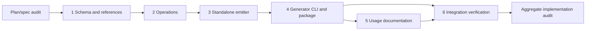

# OpenAPI JSON to Effect CLI Implementation Plan

> **For agentic workers:** REQUIRED SUB-SKILL: Use superpowers:subagent-driven-development or superpowers:executing-plans task-by-task. The operator has selected **Tugboat Mind/Hand**; preserve that execution method. Mind routes the units below, Hands implement, and independent seats own the declared audit/integration gates. Steps use checkbox syntax for tracking.

**Goal:** Generate and execute standalone Effect CLI applications from a deliberately supported OpenAPI JSON subset.

**Architecture:** Decode untrusted JSON into a validated operation/schema model, then deterministically emit direct Effect command definitions and a small reusable HTTP/body helper. Keep generator filesystem access in its CLI; generated applications depend only on Effect and its Node platform.

**Tech Stack:** Bun 1.4.3; TypeScript 7.0.2; `effect` 4.0.3; `@effect/platform-node` 4.0.3; Node ESM runtime; Bun tests; existing Vite+/Ultracite hygiene.

**Spec:** `docs/superpowers/specs/2026-10-11-generator-design.md`.

## Global Constraints

- OpenAPI JSON is primary; HttpApi shorthand remains deferred.
- One package; no examples, benchmarks, infrastructure, or artificial package hierarchy.
- Keep this repository private; no push, publication, deployment, or merge to main.
- Generate native Effect CLI commands, flags, help, parsing, and validation; no custom parser or runtime OpenAPI interpreter.
- Keep HTTP methods, paths, property names, and request values independent of command spelling.
- Require `operationId`, flat normalized command names, explicit shared `--base-url`, and JSON `--body` or `--body-file` inputs.
- Reject unsupported request semantics with typed location-bearing errors before producing files.
- No silent coercion, default application, unknown-field stripping, request retry, or operation skipping.
- The generator library performs no filesystem/network access. Generated output does not import the generator.
- Preserve unrelated dirt. Planning baseline is `2d7e15b905644b61b8e78bb4c6f0ba84d7f57dcf`; `.vivi/` is foreign coordination state.

## Review Focus

1. API strings containing quotes, newlines, backticks, `${...}`, `__proto__`, or code must remain data (Units 2–3).
2. Optional boolean `false`, empty string, zero, and absent query/body values must remain distinct (Units 2–3 and 6).
3. Version-dependent nullable/ref semantics and nested additional properties must not silently widen/narrow requests (Units 1 and 6).
4. Base paths, encoded separators, dot segments, and parameter-name collisions must not route a request elsewhere (Units 2–3 and 6).
5. Existing output targets, halfway write failures, HTTP errors, and interruption must produce truthful failure without foreign-data loss (Units 4 and 6).

## Repository and API evidence

README says tooling foundation only. Existing scripts are `format`, `lint`, `typecheck`, `check`, `fix`; tsconfig includes only `vite.config.ts`. The managed worktree has no `node_modules`; source inspection used the primary checkout's installed packages, whose package metadata reports 4.0.3. No dependencies were installed during planning.

Verified from installed source:

- `effect/cli`: `Command.make`, `Command.withSubcommands`, `Command.withSharedFlags`, `Command.withDescription`, `Command.run`; descendants read shared values using `yield* parentCommand`.
- `Flag.String`, `Flag.Boolean` (presence/`--no-name`), `Flag.Int`, `Flag.Finite`, `Flag.Literals`, `Flag.optional` (`Option`), `Flag.mapEffect`, `Flag.withDescription`, `Flag.Path`.
- `effect`: `Schema.TaggedError<Self>()`, `Schema.Struct`, `Schema.StructWithRest(struct, [record])`, `Schema.Record(key, value)`, `Schema.optionalKey`, `Schema.Array`, `Schema.Literals`, `Schema.NullOr`, `Schema.Finite`, `Schema.Int`, `.check`, `Schema.makeFilter`, `Schema.decodeUnknownEffect(schema, options)(input)`.
- `SchemaAST.ParseOptions.onExcessProperty` accepts only `ignore` or `error`; default `ignore` strips keys. Do not assume a `preserve` mode.
- `effect/http`: `HttpClientRequest.make(method)(url)`; `HttpClientRequest.bodyJson(request, value)` returns an Effect; `HttpClient.execute(request)`; response `status` and `text` Effect. Do not derive the method from the command.
- `@effect/platform-node`: `NodeServices.layer`, `NodeHttpClient.layerNodeHttp`, `NodeRuntime.runMain`.
- `FileSystem.FileSystem` includes `readFileString`, `makeDirectory`, `writeFileString`, `remove`; exclusive directory creation uses `makeDirectory` without recursive mode. `Stdio` exposes stdout/stderr sinks; `Stream.make(text).pipe(Stream.run(stdio.stdout({ endOnDone: false })))` avoids added output newlines.

Source locations: `node_modules/effect/src/cli/{Command,Flag,GlobalFlag}.ts`, `Schema.ts`, `SchemaAST.ts`, `http/{HttpClient,HttpClientRequest,HttpClientResponse,HttpIncomingMessage}.ts`, `FileSystem.ts`, `Stdio.ts`, and `node_modules/@effect/platform-node/src/{NodeServices,NodeHttpClient,NodeRuntime}.ts`.

Version semantics checked against [OAS 3.0.3](https://spec.openapis.org/oas/v3.0.3.html) and [OAS 3.1.1](https://spec.openapis.org/oas/v3.1.1.html). Vault filename/content search found only Blu's unrelated Forge; that note does not describe Cloudflare Forge or this repository. No matching project note was found or changed.

## Exact contracts and emitted files

Public export from `src/index.ts`:

```ts
interface GenerateOptions { readonly name: string }
interface GeneratedFile { readonly path: string; readonly content: string }
interface GeneratedApplication { readonly files: ReadonlyArray<GeneratedFile> }
// Input is parsed JSON, not JSON text. No hidden filesystem service requirement.
generate(document: unknown, options: GenerateOptions): Effect.Effect<GeneratedApplication, GenerationError>
```

`GenerationError` is one `Schema.TaggedError` with `code: "invalid_input" | "unsupported" | "invalid_options"`, `location: string` (escaped JSON Pointer, or `/options/name`), `message: string`, and `hint: string`. Empty hint means no supported alternative. Fail deterministically at the first invalid location in lexical traversal. Catch expected boundary exceptions with `Effect.try`; do not turn programmer defects into success/fallbacks.

`name` must match `/^[a-z][a-z0-9]*(?:-[a-z0-9]+)*$/` and avoid reserved root/global command spellings. It is the generated package/bin/root command name. Generated version is `0.0.0`; no version/options scaffolding is needed.

Emit exactly five files, in the following fixed order, with LF and final newline:

1. `src/main.ts`: shebang, generated schemas/explicit commands, root/runMain wiring.
2. `src/runtime.ts`: small generated helper for base URL, JSON body, HTTP execution, errors, stdout/stderr.
3. `package.json`: private ESM package, bin `{ [name]: "./dist/main.js" }`, dependencies pinned to the two 4.0.3 packages, TypeScript 7.0.2 and `@types/node` 26.6.4 dev dependencies. Scripts `build: tsc -p tsconfig.json`, `start: node dist/main.js`.
4. `tsconfig.json`: strict, ES2022, NodeNext module/resolution, rootDir `src`, outDir `dist`, declarations false, types node, includes `src/**/*.ts`.
5. `.gitignore`: `node_modules/` and `dist/` only.

Imports between generated files use `.js`. Generator library build similarly uses NodeNext with `.js` source imports; build output preserves a shebang on `dist/cli.js`.

Generator invocation: `effect-openapi-cli-generator --input ./openapi.json --output ./generated --name my-api`. Three required native flags, no implicit output/name. Generated invocation: `my-api get-report --base-url https://host.test/api --report-id abc --body '{"enabled":false}'`. Help works without base-url; invocation without an operation renders native root help.

Internal model in `src/model.ts`:

```ts
type HttpMethod = "GET" | "PUT" | "POST" | "DELETE" | "OPTIONS" | "HEAD" | "PATCH" | "TRACE"
type JsonScalar = string | number | boolean | null
type WireSchema =
  | { readonly kind: "string" | "boolean" | "integer" | "number" | "null"; readonly nullable: boolean; readonly enum: ReadonlyArray<JsonScalar> | undefined }
  | { readonly kind: "array"; readonly nullable: boolean; readonly items: WireSchema }
  | { readonly kind: "object"; readonly nullable: boolean; readonly properties: ReadonlyArray<{ readonly name: string; readonly required: boolean; readonly schema: WireSchema }>; readonly additionalProperties: boolean }
interface Parameter {
  readonly wireName: string; readonly flagName: string; readonly location: "path" | "query"
  readonly required: boolean; readonly schema: WireSchema; readonly description: string | undefined
}
interface Operation {
  readonly commandName: string; readonly operationId: string; readonly method: HttpMethod
  readonly path: string; readonly parameters: ReadonlyArray<Parameter>
  readonly description: string | undefined
  readonly body: { readonly required: boolean; readonly schema: WireSchema } | undefined
}
interface ApiModel { readonly operations: ReadonlyArray<Operation> }
```

Bodies are restricted to JSON scalar enums matching the declared primitive type. Arrays/object enum values are rejected. Null enums do not override nullable/version semantics. No validation keyword is lost from this model: unsupported restrictions are rejected before normalization.

Internal signatures:

```ts
normalizeSchema(document: unknown, schema: unknown, location: string, version: "3.0" | "3.1", activeRefs?: ReadonlySet<string>): Effect.Effect<WireSchema, GenerationError>
normalize(document: unknown): Effect.Effect<ApiModel, GenerationError>
emit(model: ApiModel, options: GenerateOptions): GeneratedApplication
```

`normalizeSchema` owns schema references; `normalize` owns parameter/requestBody references. A shared resolver in `src/references.ts` returns `{ value: unknown; location: string; activeRefs: ReadonlySet<string> }` through `Effect<..., GenerationError>`; takes `(document: unknown, ref: string, location: string, activeRefs: ReadonlySet<string>)`. It never mutates its input. The active reference set follows only the current traversal branch; repeated shared references are not cycles.

## Supported/rejected behavior

### Schema keyword matrix

| Feature | Supported interpretation | Reject |
| --- | --- | --- |
| `type` | 3.0 one explicit primitive/object/array type; 3.1 same plus `null`, or exactly one non-null type plus null in a two-member array | missing type, boolean schema documents, other type unions/types |
| `nullable` | 3.0 boolean, only alongside explicit type; 3.1 null union/type | `nullable` in 3.1; nullable path/query parameters |
| `properties`, `required` | object properties, unique required strings that name declared properties; absent required means none | required undeclared fields; malformed lists; these keywords on non-object |
| `additionalProperties` | absent/true allows arbitrary JSON extras; false rejects extras recursively | schema-valued additionalProperties in this slice |
| `items` | one supported schema, required for array | tuple/prefixItems, missing items |
| `enum` | nonempty unique JSON primitive values consistent with type/nullability | objects, arrays, inconsistent or duplicate values |
| `$ref` | `#/...` JSON Pointer, ~0/~1 escaping and percent-decoded fragment; local schemas/parameters/requestBodies; own-property traversal | external, unresolved, recursive, invalid escaping; validation siblings on schema refs in 3.1; request-affecting reference siblings |
| descriptive annotations | title, description, deprecated, default, example(s), externalDocs, `$comment`, and `x-*`; never applied as defaults | unknown non-annotation keywords |
| other validation/encoding | none in first slice | minimum/maximum, exclusive bounds, multipleOf, min/maxLength, pattern, format, min/maxItems, uniqueItems, min/maxProperties, const, allOf/oneOf/anyOf/not, discriminator, readOnly/writeOnly, XML, contentEncoding/mediaType, patternProperties, unevaluatedProperties, conditionals, `$id`/anchors/dynamic refs, custom `$schema`/dialect |

This is an explicit subset, not a promise to accept every primitive schema restriction. Native schemas represent supported type/enum/required/null/additional-property rules; unsupported restrictions produce location + hint instead of disappearing. JSON unknown additional values are safe because bodies originate in JSON parsing. Always send the original parsed value after successful decode, never the decoder's result. Closed objects use `Schema.Struct` with excess-property error; open objects use `Schema.StructWithRest(..., [Schema.Record(Schema.String, Schema.Unknown)])`. Use computed object keys or entry arrays for untrusted names such as `__proto__`.

### Operation/parameter normalization

- Accept `openapi` matching `3.0.x`/`3.1.x` numeric patch, valid `info` title/version and `paths` object; reject no-operation documents and other versions. Validate request-bearing locations and all reusable schemas/parameters/requestBodies, including unused definitions. Responses are structurally checked and scanned for links; their schemas are intentionally not converted or judged by the request-schema subset. Unknown request keys fail; ordinary documented metadata and `x-*` may be ignored.
- Iterate paths lexically and methods in fixed order GET, PUT, POST, DELETE, OPTIONS, HEAD, PATCH, TRACE. Only these method keys are operations. Reject webhooks, callbacks, response links, path-item refs, and nonempty root or operation security requirements. Empty `security: []` is supported. Unused security scheme definitions are descriptive to this slice.
- Split acronym-to-word and lowercase-to-uppercase boundaries, replace underscores with hyphens, lowercase; require resulting token `/^[a-z][a-z0-9]*(?:-[a-z0-9]+)*$/`. Thus `getHTTPReport` → `get-http-report`, `get_report` → `get-report`. Reject duplicate operationId or resulting command tokens; do not suffix collisions.
- Flag spelling uses the same normalization but retains original wire name. Reject collisions within each operation, reserved names `base-url`, `body`, `body-file`, `help`, `h`, `version`, `v`, `wizard`, `completions`, `log-level`, plus the generated `no-<boolean-flag>` spelling. Do not reserve harmless wire names globally across separate commands.
- Merge path-item and operation parameters by `(in, name)`, with operation override. Reject duplicates within either source list. Path parameters must be required, have exactly matching placeholders, and use simple style. Query parameters use form style. Accept boolean explode defaults or either boolean when it has no effect on primitive serialization; reject allowReserved true, allowEmptyValue true, content parameters, header/cookie locations, and arrays/objects/nullability. Optional query remains Option, including false/zero/empty string when present.
- Paths start with `/`; reject query/fragment components, malformed placeholders, URL dot segments, ambiguous duplicate templated paths, and literal unescaped whitespace/control characters. Never interpolate path values as source. Validate supplied base URL as http(s), with no credentials/query/fragment; join by trimming trailing base slash and appending operation path without replacing base path. RFC3986-encode substituted primitive path values once; query uses URLSearchParams with original names. Reject standalone dot/dot-dot path substitutions because WHATWG URL normalization would alter routing.
- Request body content must be exactly `application/json` with a schema; reject other or multiple media choices and encoding directives. Optional absence sends no Content-Type/body. Required body needs exactly one input; both inputs always fail. No-body operations expose neither body flag. Reject GET/HEAD request bodies explicitly: the target HTTP client cannot faithfully promise them.
- Help uses summary + description with a newline when both exist, and parameter descriptions verbatim as data.

### Generated execution

Use generated constants `schema0`, `operation0`, and `parameter0` keyed by deterministic ordinals; never untrusted identifiers. Root is created before child handlers so `yield* root` reads shared `baseUrl`. Bind `Flag.String("base-url")` with `Flag.mapEffect` URL validation; other flags use native types or string literals, with `Flag.optional` only for optional values. Required boolean flags retain native `--enabled`/`--no-enabled` semantics.

Generated `src/runtime.ts` contract:

```ts
type RequestFailure = InvalidBaseUrl | InvalidBody | RequestFailed | HttpStatusFailure
// Schema.TaggedError classes; InvalidBody has message/source, RequestFailed message,
// HttpStatusFailure status/body; InvalidBaseUrl message/value.
validateBaseUrl(value: string): Effect.Effect<string, InvalidBaseUrl>
readBody(input: { readonly body: Option.Option<string>; readonly bodyFile: Option.Option<string> }, required: boolean, schema: Schema.Codec<unknown>): Effect.Effect<Option.Option<unknown>, InvalidBody, FileSystem.FileSystem>
executeRequest(method: HttpMethod, url: string, body: Option.Option<unknown>): Effect.Effect<void, RequestFailed | HttpStatusFailure, HttpClient.HttpClient | Stdio.Stdio>
```

`readBody` uses Effect FileSystem, `Effect.try` JSON parsing, and `Schema.decodeUnknownEffect`. Map expected file/schema failures into InvalidBody with path/details. `executeRequest` acquires client, attaches JSON only for Some body, consumes response text within scoped lifetime, treats only 200–299 as success, and writes successful text exactly to stdout (empty writes nothing). Map HTTP/body/read/output failures to RequestFailed; retain status and body for HTTP failures. Do not add redirects/retries; configure the selected Node client to preserve method/path and test its actual behavior. At entry point render request error messages to stderr once and preserve failure/nonzero exit via NodeRuntime; native CLI parse errors keep native rendering. Interruption closes the connection/resource scope.

## Delivery graph and verification ownership



Mind obtains independent plan/spec audit before dispatch, resolving blocking decisions below. Every Hand commits its own logical change and reports narrow proofs; no per-unit aggregate audits. Unit 6 owns final project/package/generated-app gates. The aggregate audit reviews the complete landed local range and receipts after Unit 6; no test reruns without a new risk/change. No main merge is part of this graph.

### Unit 1: Schema/reference boundary

**Prerequisite:** approved plan/spec audit.
**Read scope:** README, spec, this plan, installed Schema source.
**Write scope:** `src/model.ts`, `src/errors.ts`, `src/references.ts`, `src/schema.ts`, `tests/schema.test.ts`, `tsconfig.json`, `package.json` (only add `test: bun test`). Include `src/**/*.ts` and `tests/**/*.ts` in existing tsconfig; retain vite config.
**Interfaces:** Produce WireSchema, GenerationError, resolver, normalizeSchema exactly above. No filesystem/network service.

- [ ] Write failing `schema.test.ts` tables: nested object/array, false extras, allowed extras with `__proto__`, enum/null combinations in each version, ~0/~1/percent pointers, repeated ref vs recursive ref, unsupported matrix rows, wrong keyword value types. Assert `Effect.flip` error tag/code/location/hint.
- [ ] Run `bun test tests/schema.test.ts`; verify failures are missing contract/behavior.
- [ ] Implement immutable reference expansion and supported keyword decoding with Effect typed errors; type-only exports carry the closed model. Do not use a third-party OpenAPI interpreter.
- [ ] Run `bun test tests/schema.test.ts`; all tables pass. Do not run project gates here.
- [ ] Stage only write-scope files and commit `feat: validate supported OpenAPI wire schemas`.

**done_when:** supported schema model/ref expansion rejects every unsupported validation keyword, with exact diagnostic pointers; targeted tests pass; local commit receipt.

### Unit 2: Operation normalization

**Prerequisite:** Unit 1.
**Read scope:** Unit 1 source/contracts, spec, installed CLI global flag source.
**Write scope:** `src/normalize.ts`, `tests/normalize.test.ts` only.
**Interfaces:** Consume model/errors/schema/resolver; produce normalize(document) exactly above.

- [ ] Write failing tests for acronym normalization, missing/colliding identifiers, parameter override/duplicates/reserved and negated boolean collisions, GET-named POST, nullable parameter rejection, path placeholder consistency, unused unsupported schema, security/callback/link/media rejections, no-operation document, no input mutation.
- [ ] Run `bun test tests/normalize.test.ts`; verify contract failures.
- [ ] Implement explicit root/path/operation allowlists, version dispatch, request-body and primitive-parameter normalization. Preserve wire names/methods and sort output deterministically.
- [ ] Run `bun test tests/normalize.test.ts`; pass all boundary tables.
- [ ] Commit scoped files as `feat: normalize OpenAPI operations into CLI commands`.

**done_when:** ApiModel contains every operation or generation fails before emission; no unresolved raw OpenAPI/schema data survives; targeted tests pass.

### Unit 3: Standalone source emitter and library entry

**Prerequisite:** Unit 2.
**Read scope:** prior source/contracts and verified Effect/Node sources.
**Write scope:** `src/emit.ts`, `src/runtime-source.ts`, `src/index.ts`, `tests/emit.test.ts` only. `runtime-source.ts` emits the shared generated helper as text; do not add a second runtime package.
**Interfaces:** Consume normalize/model/options; produce emit and generate exactly above. Produce all five generated file contracts and runtime signatures.

- [ ] Write failing `emit.test.ts` assertions for five exact paths, stable output, fixed dependency metadata, invalid names, correct uppercase HTTP literal despite get-prefixed command, native shared flags, parameter mappings, body Schema definitions, absent body flags, and no generator import.
- [ ] Add hostile quote/newline/backtick/${...}/prototype-key input cases; parse emitted TS with TypeScript's parser and assert no syntax diagnostics or extra injected statements. Assert untrusted strings occur only as escaped literals/computed property keys. Full generated compilation belongs to Unit 6.
- [ ] Run `bun test tests/emit.test.ts`; observe failures.
- [ ] Implement safe string literals through JSON.stringify with explicit U+2028/U+2029 escaping; JSON metadata through serialization, never textual substitutions. Generate explicit per-operation schemas/flags/handlers plus shared helper; no OpenAPI tables at startup. Add Schema validation preserving original input and nontransforming open-object handling.
- [ ] Run `bun test tests/emit.test.ts`; pass all public generation tests.
- [ ] Commit scoped files as `feat: emit standalone Effect CLI applications`.

**done_when:** deterministic library result has declared files, direct native commands and safe source literals, typed validation failures, no IO or generator runtime dependency; targeted tests pass. Compilation correctness remains explicitly pending Unit 6.

### Unit 4: Generator CLI, output ownership, package surface

**Prerequisite:** Unit 3.
**Read scope:** generate contract, current package/config, Effect CLI/FileSystem/NodeRuntime source.
**Write scope:** `src/cli.ts`, `src/write.ts`, `tests/write.test.ts`, `tests/cli.test.ts`, `package.json`, `tsconfig.build.json`, `src/errors.ts` (add output error class only).
**Interfaces:** Consume generate. Produce `writeApplication(application: GeneratedApplication, output: string): Effect.Effect<void, OutputError, FileSystem.FileSystem | Path.Path>`; OutputError fields code (`exists`/`io`), path, message. CLI maps JSON read/parse, generation, and output failures to one useful stderr diagnostic and nonzero status.

- [ ] Write failing output tests: existing directory/file/symlink remains untouched; concurrent creator causes exclusive directory creation to fail; missing parent fails usefully; successful files stay inside claimed output; injected write failure removes only the directory this invocation exclusively created. Validate GeneratedFile paths before writing even though emitter owns them.
- [ ] Write CLI tests via native `Command.runWith` and Effect platform test layers: required flags/help, malformed JSON location, error stderr, and no partial output on invalid spec. Export `generatorCommand` from cli module for tests; guard executable launch with direct-entry detection.
- [ ] Run `bun test tests/write.test.ts tests/cli.test.ts`; observe failures.
- [ ] Implement exclusive output-directory creation and scoped cleanup for failure/interruption before success. Never use pre-check as sole overwrite protection. Do not delete an unclaimed target or parents. File writes use exclusive `wx` and known relative paths.
- [ ] Add package exports `.: { types: ./dist/index.d.ts, import: ./dist/index.js }`, bin `effect-openapi-cli-generator: ./dist/cli.js`, files `[dist]`, scripts `build: tsc -p tsconfig.build.json`, `test: bun test`. Build config extends strict config, enables emit/declarations, disables allowImportingTsExtensions, NodeNext, rootDir src/outDir dist, includes only src and types node. Keep `private: true`.
- [ ] Run `bun test tests/write.test.ts tests/cli.test.ts`; pass. Full build/package proofs belong to Unit 6.
- [ ] Commit scoped changes as `feat: expose generator CLI and package entry points`.

**done_when:** library/bin/build contract declared, filesystem writes have exclusive ownership and safe failure cleanup, native CLI input/output is tested narrowly; no foreign target overwritten.

### Unit 5: Implemented usage documentation

**Prerequisite:** Unit 4.
**Read scope:** final implementation and supported matrix; Unit 4 receipt.
**Write scope:** `README.md` only.
**Interfaces:** Consume implemented package/bin commands and supported behavior; produce truthful user documentation.

- [ ] Replace tooling-only status with actual local implementation status. Document generation invocation, generated install/build/start, boolean negative flag syntax, base URL semantics, supported/rejected input, and error/output ownership. Keep references and deferred HttpApi/publication scope.
- [ ] Check each documented invocation against declared scripts/export/bin/source; avoid asserting final verification before Unit 6.
- [ ] Commit README as `docs: describe generator usage and supported OpenAPI subset`.

**done_when:** README matches final CLI/package contracts and limits; no new example application or unsupported claim. No product test replay required for prose.

### Unit 6: Final integration and package verification

**Prerequisites:** Units 4 and 5.
**Read scope:** full implementation, package/export/bin metadata, prior narrow receipts.
**Write scope:** `tests/integration.test.ts`, `tests/package.test.ts`, `package.json` (add `test:integration: bun test tests/integration.test.ts tests/package.test.ts`); repair product files only through newly scoped units if failures identify broader defects.
**Interfaces:** Consume built generator and generated five-file application; produce durable complete proof receipt. This unit alone owns project-wide format/lint/typecheck/build and real generated application build/execution.

- [ ] Implement fixture objects inside tests (no example app); invoke built generator CLI in a temporary parent to create absent target. Install generated declared dependencies with `bun install`, build using its actual `bun run build`, execute `node dist/main.js`; do not link the generator into output or reuse stale dist. Tests use real local HTTP server/processes and bounded deadlines, cleaning resources in finalizers. Dependency-install failure is an environmental blocker, never a product pass.
- [ ] Use one generated application carrying POST `getReport`, primitive path/query flags including bool/string enum, nested closed/open objects/arrays/null bodies, and an optional-body operation. Server assertions pin method, `/api` base path, `%2F` path values, encoded Unicode/reserved query names, `false`, `0`, empty string, omitted optionals, content type/body and raw success stdout without newline.
- [ ] Test root/operation help without base-url; missing flags, enum errors, invalid protocol/query/hash/credential base URLs, body inputs both/missing, malformed file/inline JSON, wrong/nested body type, extra property false vs true preservation, absent optional body, 204, non-2xx status/body on stderr with nonzero exit, refused connection, and SIGINT of delayed request. Invalid input must make no HTTP request. SIGINT must end child within deadline and release server connection; do not insist on one platform-specific exit code.
- [ ] Build a second hostile-string generated app from Unit 3 cases, compile with declared dependencies and prove invocation sends strings as data. Test source parser alone is insufficient here.
- [ ] Package tests run clean generator build, `npm pack --dry-run --json` without publication, confirm dist/index.js + .d.ts + cli.js are included and tests/.vivi/node_modules are absent. Import library via package name from a temporary consumer of a local packed tarball; execute the installed bin's `--help`. Check actual shebang/executable behavior and add chmod in build only if packaging requires it. No external registry mutation.
- [ ] Run `bun run test:integration`, `bun run build`, then `bun run check`; expected all pass with current source/output. If formatting fails, limit fixes to scoped/new implementation files; rerun affected proofs after semantic fixes. `git diff --check` must pass.
- [ ] Commit integration tests/scripts as `test: verify standalone generated CLIs and package surfaces`; record exact commands/results, Node/Bun versions, local commit range, environmental blockers and residuals through Vivi. Mind obtains aggregate implementation audit before claiming phase complete.

**done_when:** current generated application builds and executes independently, wire/validation/failure/interruption contracts pass, library/export/bin/pack proof passes, normal repo checks pass, and local receipt names the commit and proofs. No publication or deployment claim.

## Operator decisions and audit corrections

The spec is not edited by this plan. The following explicit subset choices should be accepted or adjusted at the preimplementation review boundary, then reflected in the controlling spec if necessary:

1. Reject schema-valued additionalProperties and all optional validation restrictions (including format/bounds) initially, rather than guessing semantics; absent/true/false additional properties and primitive enum remain supported.
2. Reject GET/HEAD bodies, path-item refs, schema `$ref` validation siblings, and standalone dot-segment parameter values; preserving them is outside the verified runtime/subset.
3. Require base URL without query/fragment/credentials and an existing output parent, with an entirely absent selected output directory; exclusive claim and cleanup prevent overwrite races.
4. Use explicit generator `--name` and five generated files, native boolean `--no-name`, pinned 4.0.3 dependencies, and NodeNext compilation. These are routine conventions but visible product contracts.

No unresolved execution-method decision: Tugboat is selected. Planner produces/commits this document only. Review is the Mind's next boundary; the planner does not file Hand tasks or start implementation.

## Planning self-review

- Spec coverage: input/library/CLI/standalone output in Units 1–4; docs in 5; deterministic, package, wire, failure, interruption and hygiene acceptance in 3 and 6; declared unsupported choices routed above.
- Signature consistency: model, generation, emitter, filesystem, runtime contracts named once; generated methods/types separate from command strings; service requirements explicit.
- Boundary fidelity: JSON/body/schema inputs remain untrusted until parsing; wire properties and original bodies retained; references use own-property traversal; source names use ordinals.
- Proof economy: targeted Hand tests only; integration owns actual build/export/bin/generated execution and project hygiene; independent audit owns range review.
- Planning validation: `git diff --check` and document self-review only. Product tests/builds intentionally not run before implementation exists.
