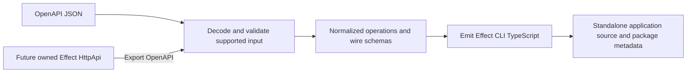

# OpenAPI JSON to Effect CLI: first implementation

## Purpose and agreed direction

Build a package that generates inspectable, standalone TypeScript CLI applications from OpenAPI JSON. Generated applications use Effect's CLI library for commands, flags, help, parsing, and validation, and Effect services for HTTP, files, errors, and runtime execution. They must not require this generator package at runtime.

OpenAPI JSON is the primary input. A future Effect HttpApi adapter will export an owned API to OpenAPI and call the same generator. It will not introduce a second generation pipeline.

The user approved starting with an end-to-end slice: read a document, generate Effect CLI source, build it, and verify the generated command sends the correct request. The operator approved the Forge-style direction, naming and documentation conventions, and implementation through Vivi/Tugboat. The independent delivery audit is a technical gate, not another operator approval request.

## Architecture

Use one package and a small source directory. Separate input decoding, operation normalization, and source emission where their responsibilities differ; do not create workspace packages or speculative infrastructure.

Provide a library generation entry point returning generated files through an Effect with typed errors. A thin generator CLI reads a local JSON file and writes those files to an explicitly selected output directory. Keep filesystem access outside normalization and emission. Refuse to overwrite an existing output target.

Generated output includes TypeScript source, package metadata, and a TypeScript configuration with explicit build and run scripts. Target Effect 4.0.3 APIs, including `effect/cli`, Config, Schema, HttpClient and FileSystem, and the Node platform runtime. Generate native help and completions; never implement a custom parser. Keep this repository private; publication is outside this stage.

## Supported input

- OpenAPI 3.0.x and 3.1.x JSON documents, interpreted according to their version.
- Resource/action addresses come from `x-fern-sdk-group-name` (dotted string or string array) and `x-fern-sdk-method-name`. Nest groups to arbitrary depth. If method metadata is absent/empty, use the final hyphen/underscore-separated `operationId` segment, falling back to `get` only when that segment is empty. No flat operationId command scheme.
- Follow Forge init conventions: operations without a string operationId are skipped; operations without a group or aliases are skipped. `x-forge-aliases`, when supplied as an array, replaces the primary projection; each entry supplies group/method metadata for the same wire operation. Reject malformed supplied metadata, unsafe command tokens, duplicate full command addresses, and action/group prefix conflicts. Empty output fails usefully.
- Enriched OpenAPI JSON is sufficient; applying overlay documents is deferred. This is a bounded Forge-style implementation, not full Forge parity.
- Local JSON Pointer references to reusable parameters, request bodies, and schemas. Decode pointer escaping correctly. Reject unresolved, external, and recursive references in this slice.
- Primitive string, boolean, integer, and number path and query parameters. Support string enums and required/optional query parameters. Path parameters must be required and match the path template.
- Path `simple` serialization and query `form` serialization for those primitives, using specification defaults when omitted. Reject other serialization styles, arrays or objects in parameters, and unsupported parameter locations.
- JSON request bodies with schemas composed of primitives, objects, arrays, required fields, enums, and explicit additional-property behavior. Support nullable values according to the OpenAPI version. Preserve schema restrictions only when they can be represented faithfully; reject unsupported schema keywords that affect validation rather than drop them.
- Optional and required request bodies. Select `application/json` explicitly; reject unsupported request media types.

Validate document shape and selected operations before emitting files. Unrecognized descriptive metadata may be ignored; request-affecting features may not be ignored. Reject unsupported security requirements, callbacks, and links in this slice. Response schemas are not converted into typed clients in this stage; responses are handled as wire data.

Errors identify the input location, unsupported feature or invalid value, and the supported alternative where one exists. Only the documented metadata-selection cases are skipped. Validate selected operations and their reachable request schemas; unused definitions and unselected operations do not fail the supported-subset check.

## Generated CLI behavior

- Use `Command.make` and subcommands from Effect CLI. Generate each operation as an explicit command definition and handler rather than interpret the whole OpenAPI document at startup.
- Use native Flag and Argument definitions. Path identifiers before the final path identifier are parent flags; the final identifier is the subject positional, except action `list`, `bulk`, or `bulk-*`, where every path identifier is a flag. All query parameters are flags. Reject duplicate effective flags, including native globals and boolean negations; retain wire names independently.
- Derive help from operation summaries/descriptions and parameter descriptions. Emit meaningful JSDoc for operations, schema declarations and described fields/parameters, including `@deprecated` and `@see` for externalDocs. Escape comment terminators and prevent text from becoming code or unintended JSDoc tags. Omit boilerplate comments. Let Effect CLI provide usage, help, completions, parsing errors, and dispatch.
- Public `generate(document, options?)` and generator `--name` accept an optional executable name. Otherwise derive a lowercase kebab slug from `info.title`; require an explicit name if no safe slug results. Keep `info.title` as the display title and `info.description` as root help. Generated package/CLI version is initially `0.0.0`, independently of API `info.version`.
- Format emitted TypeScript using Oxfmt 0.70.0 with the repository JSDoc options. The generator declares that runtime dependency; generated applications do not need it. Integration verifies emitted code with repository Oxlint rules and TypeScript.
- Keep the OpenAPI HTTP method and original path separate from the command name. A command named `get-report` may issue POST if that is the defined method.
- Require an explicit shared `--base-url` HTTP(S) URL. Do not guess a server from the OpenAPI document. Preserve a supplied base path when appending operation paths and serialize path/query values with correct encoding.
- For JSON bodies, expose mutually exclusive `--body` and `--body-file`. `--body` accepts inline JSON only; `--body-file` is the sole file convention (no implicit `@file`). Read files through Effect FileSystem, parse JSON, and validate using generated Effect schemas before issuing HTTP. Require one input for a required body; omit the body entirely when an optional body is absent.
- Preserve wire property names and values. Validation must not strip unknown fields, coerce values, apply defaults, or otherwise transform the request silently.
- Use Effect HttpClient and HTTP body APIs, providing the appropriate client and platform layers at the entry point. Do not invent a CLI parser or use ad hoc fetch and filesystem wrappers.
- Print the response body to stdout without interpreting it through a generated response schema. Report transport errors and non-success HTTP statuses as typed failures with useful status/body information and a nonzero exit. Handle empty response bodies successfully. Use stderr for diagnostics.
- Let the Effect runtime handle interruption and resource cleanup.

"Optimal Effect CLI code" means idiomatic use of the library's existing capabilities, readable direct definitions, faithful requests, and minimal generated runtime machinery. It does not mean choosing shorter output at the expense of correctness.

## Verification and acceptance

1. Unit tests exercise naming/collisions, reference resolution, version-sensitive schema interpretation, unsupported-feature diagnostics, and serialization.
2. Generation is deterministic for identical input and options. Treat API strings as data when emitting source; test quotes, newlines, and source-like strings.
3. Build a generated application in a temporary directory against its declared dependencies, then execute its built entry point. This proves current generated output is usable independently of the generator.
4. A local test server checks the actual method, encoded path, query, content type, and JSON body, including an operation whose name suggests a different verb.
5. Integration checks cover help, missing required flags, omitted optional query/body values, mutually exclusive body inputs, malformed JSON, schema-invalid bodies, empty successful responses, HTTP failures, and interruption.
6. Package build checks verify its library exports and executable entry point. Include source and tests in TypeScript checking; run `bun run check` and relevant targeted checks.
7. Update README with the implemented subset and actual usage. Commit completed implementation locally and report the hash and checks.

## Deferred scope

HttpApi shorthand, overlay application, authentication configuration, remote specification fetching, YAML, external references, recursive schemas, complex parameter serialization, multipart/file uploads, response client generation, npm publication, and deployment are deferred. No example application, benchmark suite, or infrastructure is added.

## Delivery boundary

The companion plan owns exact signatures, file contracts, schema matrix and scoped units. Existing subset restrictions remain explicit: no schema-valued additionalProperties, validation restrictions outside the matrix, GET/HEAD bodies, path-item refs, credential/query/fragment-bearing base URLs, or dot-segment path substitutions. Output requires an absent directory under an existing parent. No remote mutation is authorized.
